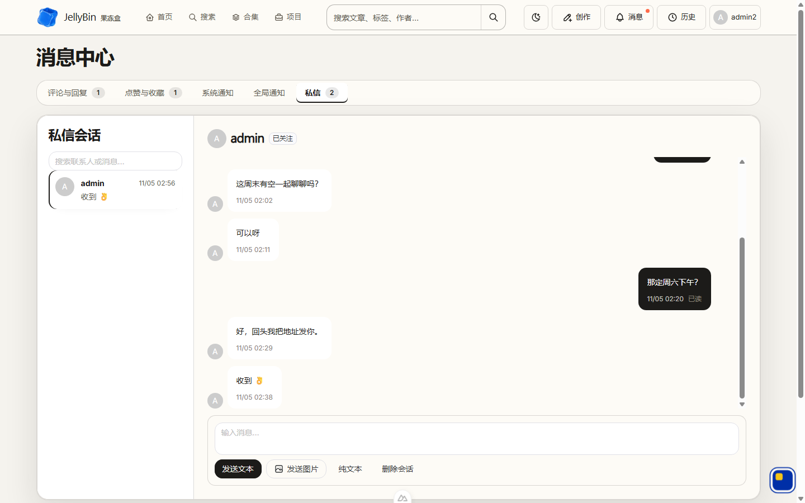
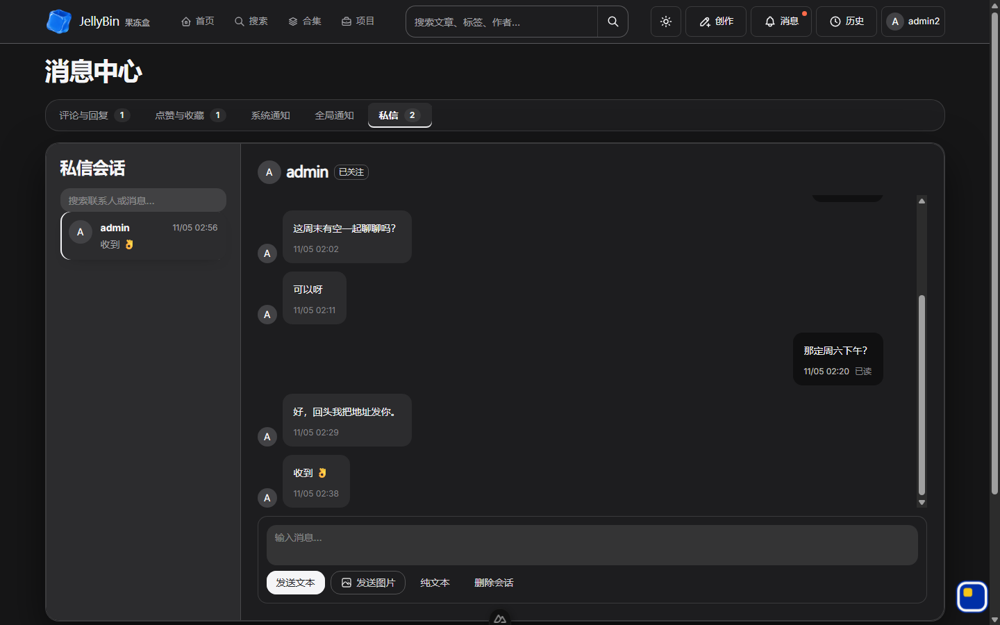
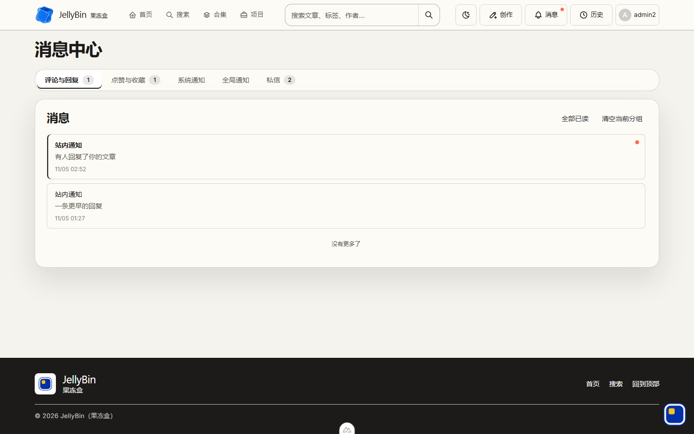

# 2026-11-05 消息中心重构 · 发布说明

- 规格：[#270](https://github.com/Jenlybein/NewblogX/issues/270)
- 决策日志：[2026-11-05 消息中心重构决定清单](./2026-11-05-message-center-redesign-decisions.md)（Q1–Q41）
- 架构决策：[ADR-0027](../adr/0027-message-center-ordering-pagination-and-read-receipt.md)（已接受）· [ADR-0022 后续修订](../adr/0022-chat-dual-channel-http-write-ws-notify.md)

## 用户可见变化

### 1. 把实现细节从界面上拿掉

私信会话里 12 处说明文案整体退役：「预备会话」徽标、首条消息才会建会话、HTTP/WS 双通道说明、对象存储上传说明、空会话卡片、输入区能力清单、页头与列表头的「聚合在这里 / 按时间倒序排列。」等。空会话与未选中会话**完全留白**，只留输入框；加载/发送失败给一句短错误 +「重试」。

连接状态条健康时**彻底不渲染**；只有断线、重连中、取票失败或 WS 异常时才在会话头低调出现，附「重连」按钮，恢复后自动消失。

### 2. 五个子项统一成顶部导航条 + 一张内容卡

原来的 220px 左侧竖导航换成顶部导航条（含未读角标），五个子项共用一张 `.surface-card`。视觉语言是克制的暖白层次：留白、细线、选中态细条、我方固定深墨气泡、上浮输入条、极细日期分隔线。全部沿用既有 `--color-*` / 五档圆角 / `--motion-*` token，亮暗双主题对比度门禁保持全绿，未引入新颜色或新 UI 库。

### 3. 后发的消息终于在下面

根因是后端 `ORDER BY send_time DESC`（最新在前）而前端原样自上而下渲染。修法：后端追加 `id` 作**确定性并列裁决**（client-key 消息主键是 FNV 哈希，绝不当时钟），前端维护唯一升序数组（最新在底部）。附带自然日分隔线（今天 / 昨天 / 日期）、同发送人 2 分钟内合并气泡组、悬停显示完整时间戳。

### 4. 进会话即已读，两个角标同时清零

根因是 `POST /api/chat/read` 前端发 JSON 字符串 ID、后端却绑 `[]uint64`，参数错误被 `.catch()` 吞掉。修法：DTO 改 `[]ctype.ID`（雪花 ID 超 2^53，绝不在前端转 number），新增 `session_id` 整会话模式一次标完，成功后同时刷新未读汇总与会话列表。自己发的消息只在最后一条保留极小的「已送达 / 已读」。

### 5. 只加载 7 条，上滑取更早

进会话取最新 7 条并贴底；上滑到顶用 `(before_send_time, before_id)` **复合游标**再取 7 条更旧的，用 `scrollHeight` 差值锁定滚动位置不跳；全部加载完只提示一次「没有更早的消息」。新消息增量追加到尾部，只有本来就贴底时才自动跟随。没有用 offset——上滑期间来一条新消息就会让后续页重复/漏条。

### 6. 其他四个 tab 进入即已读

评论与回复 / 点赞与收藏 / 系统通知 / 全局通知在首屏加载成功后按当前分组批量标记已读（复用既有接口，无新增端点），行未读与角标一起清，保留「全部已读」按钮作手动兜底。它们的分页仍是 20 条 + 下滑加载，方向由各自阅读习惯决定；**列表不订阅 WS、不轮询**，这是本批的已知边界。

### 7. 顶栏

创作 / 消息 / 历史三枚动作按钮共用等宽 class，去掉创作多出的 `0.875rem` padding。消息悬浮面板原先因为 6px 透明缝隙 + 立即 `pointerleave`，鼠标一移过去就消失；现在补透明桥接带 + 200ms 关闭宽限 + 重新进入取消，鼠标可以移入并点子项，点击立即跳到对应 tab 并关面板。补齐键盘可达：Esc 收起并回焦、方向键在五个子项间循环、焦点移出才关闭。

## 契约变化（需要前后端同批上线）

| 接口 | 变化 |
| --- | --- |
| `GET /api/chat/messages` | 新增 `before_send_time` / `before_id` 游标参数；响应从 `{list,count}` 改为 `{list,count,has_more,next_cursor}`；`list` 仍是 DESC；排序加 `id` 并列裁决 |
| `POST /api/chat/read` | `msg_id_list` 从「数字数组」改为 `[]ctype.ID`（JSON 字符串数组）；新增 `session_id` 整会话模式；0 条命中改为正常成功 |
| `clear_before_msg_id` | 消息可见性与未读并账的水位从 `id > ?` 改为基于 `send_time` 的关联子查询（零 DDL，不改表不加列） |

`backend/docs/swagger.json` 与两端 `app/types/openapi.d.ts` 已重新生成。本批**没有新表、没有列变更、没有 ALTER**，部署不需要跑 `-db`。

## 已知边界 / 不做

- 四个通知 tab 的列表仍不订阅 WS、不轮询；WS 只更新未读角标数字。
- 不抽共享分页 composable：聊天贴底上滑、通知贴顶下滑是两套方向不同的阅读模型。
- 不做 WS ack/retry、消息编辑 / 撤回、举报队列、浏览器 E2E。
- 不引入新表 / 新列 / 新颜色 / 新 UI 库；五个子项路由与语义、`ssr:false` 渲染边界、设计门禁 canary 全部保留。

## 本地 dev 关键态截图

（用本地 dev server + fixture 数据渲染，非线上截图；仅供观感确认，不代表生产数据。）

| 亮色 · 私信 | 暗色 · 私信 | 亮色 · 评论与回复 |
| --- | --- | --- |
|  |  |  |

截图里能看到：顶部导航条与单一内容卡、五个子项角标、三枚顶栏动作按钮等宽、会话选中态细条、我方深墨气泡、日期分隔「今天」、同人合并组、输入区常驻视口内、所有实现说明文案已消失、健康连接下无状态条。

## 验收清单（两个浏览器，一个无痕）

1. 亮 / 暗两态各看一次消息中心：顶部导航条、单一内容卡、五个子项角标、三枚顶栏按钮等宽。
2. 顶栏「消息」悬停 → 鼠标能移到下拉卡片 → 点「私信」直接进 `/messages/chat` 且面板关闭；Esc / 方向键 / 焦点移出也正常。
3. 文章页点「私信」→ 进入会话并选中作者；首条发出后不出现任何说明文案，空会话留白。
4. 两个账号互发文本 + 一张图：后发的在下面、日期分隔线、同人 2 分钟内合并、悬停有完整时间戳。
5. 接收方一进入会话，左侧会话角标与顶栏消息角标**同时立刻清零**；自己最后一条显示「已送达 / 已读」。
6. 造 10 条以上历史：首屏只显示最新 7 条且贴底；上滑到顶再出 7 条且视口不跳；全部加载完提示「没有更早的消息」；看历史时来新消息不被强行拽回底部。
7. 断网 / 停止 WS：会话头才出现状态条 +「重连」；恢复后自动消失。
8. 外链图片私信被拒（票 267 既有能力，回归确认）。
9. 其他四个 tab：进入即已读，但仍保留「全部已读」按钮；下滑加载 20 条不变。
